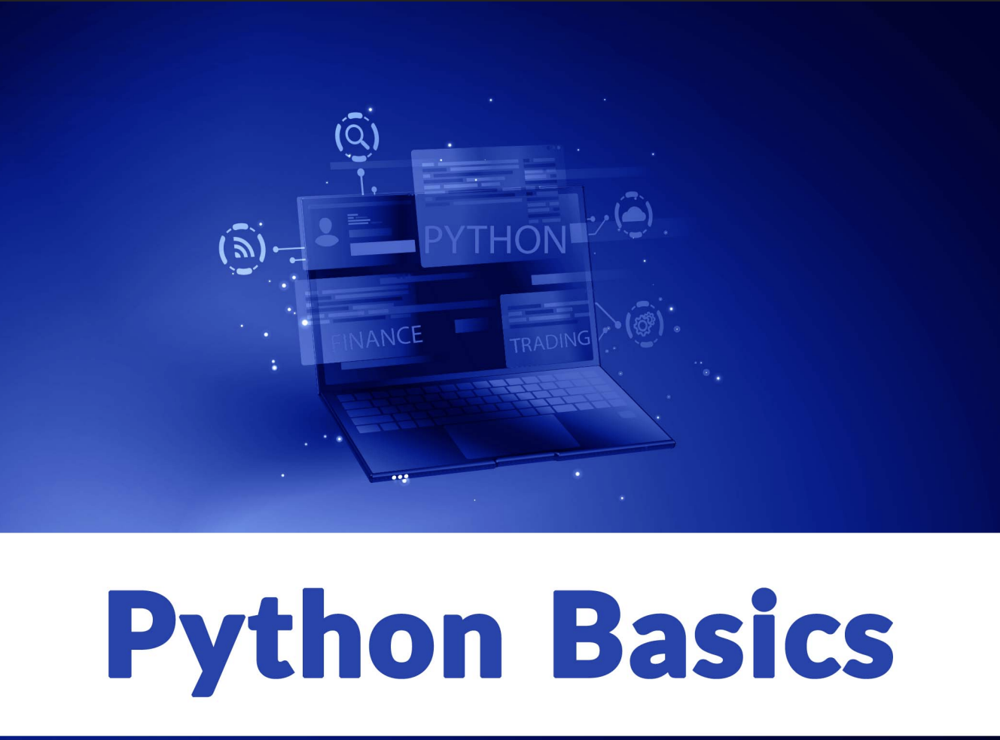

# PYTHON FROM NOVICE TO EXPERT 
Learn python from novice level to expert level for computer science and Mathematics for finance and tech

## INTRODUCTION 

Welcome to our first module on programming. In this module, we will
be discussing the nuts and bolts of the Python programming language
ranging from the very basic to more advanced topics.
Python is a general-purpose programming language that is becoming more
and more popular for
• performing data analysis,
• automating tasks,
• learning data science,
• machine learning, etc.

## ABOUT COURSE

Python is an interpreted, object-oriented, high-level programming language with dynamic semantics. Its high-level built in data structures, combined with dynamic typing and dynamic binding, make it
very attractive for Rapid Application Development, as well as for use
as a scripting or glue language to connect existing components together. Python’s simple, easy to learn syntax emphasizes readability
and therefore reduces the cost of program maintenance. Python supports modules and packages, which encourages program modularity
and code reuse. The Python interpreter and the extensive standard
library are available in source or binary form without charge for all
major platforms and can be freely distributed.

## WHY PYTHON AND BRIEF HISTORY

Python is characterized by many features. Let’s examine a few of them
here: https://wiki.python.org/moin/TkInter

### History of Python
Python is the brainchild of Guido van Rossum who started its developmental efforts in the 1980s. Its name has nothing to do with anything serpentine, it’s in fact inspired by the British comedy Monty Python! The first
Python implementation was in December 1989 in the Netherlands. Since
then, Python has gone through major turnarounds periodically. The following can be considered milestones in the development of Python:
• Python 0.9.0 released in February 1991
• Python 1.0 released in January 1994
• Python 2.0 released in October 2000
• Python 2.6 released in October 2008
• Python 2.7 released in July 2010
• Python 3.0 released in December 2008
• Python 3.4 released in March 2014
• Python 3.6 released in December 2016
• Python 3.7 released in June 2018

